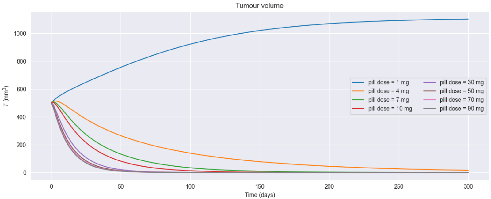
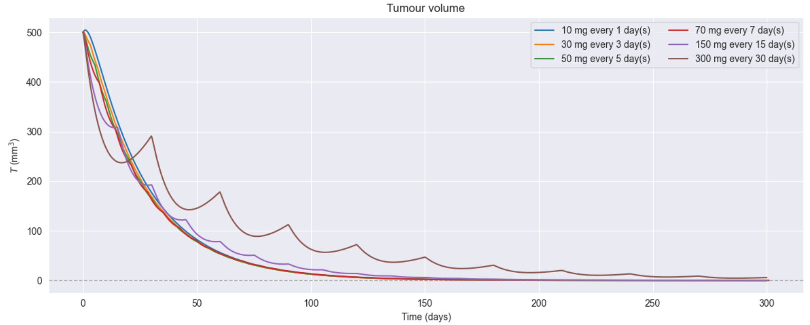
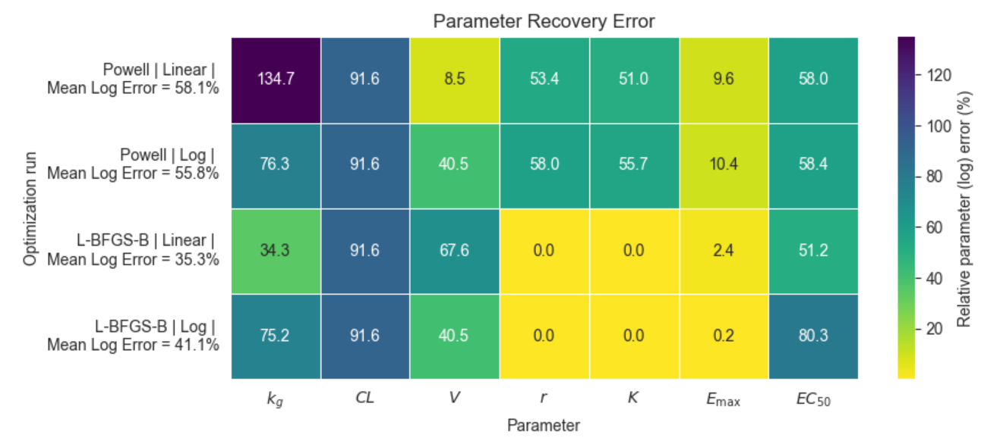
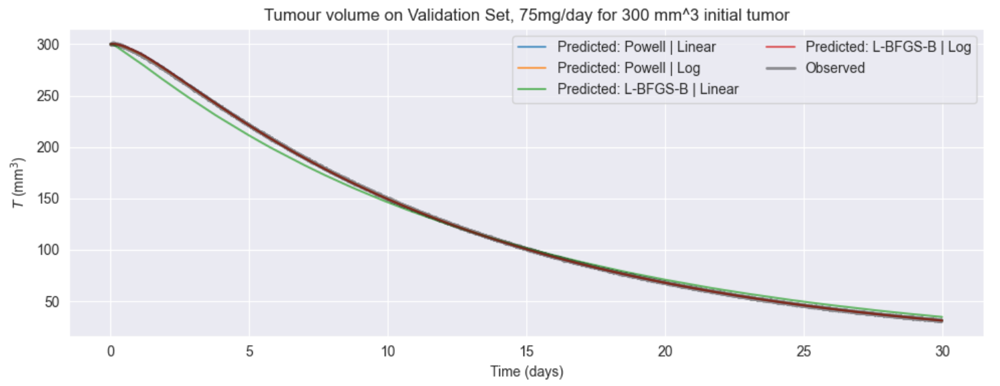

# Mechanistic Pharmacokinetics and Pharmacodynamics Modelling, ODE Simulation \& Parameter Estimation

## Overview

This project investigates a mechanistic pharmacokinetic/pharmacodynamic (PK/PD) model that couples drug concentration dynamics with tumor growth through a system of ordinary differential equations (ODEs). The study examines how model parameters, dosing regimens, and parameter-estimation strategies influence both tumor trajectories and the recovery of underlying model parameters from noisy observations.

A central objective is to distinguish parameter recovery from predictive performance: a parameter set that fits observations well or produces accurate predictions need not correspond closely to the true underlying parameters. Synthetic noisy data are therefore used to evaluate weighted least-squares estimation under different optimizers, parameter scalings, and initial conditions, followed by validation on held-out treatment conditions.

# Repository Structure
├── PD_PK_modelling.ipynb
├── figures
└── README.md

# Key Findings

- The model exhibits nonlinear treatment-response thresholds: changes in absorption, clearance, tumor growth, inhibition strength and other parameters can shift the system between tumor shrinkage and continued growth. Under repeated dosing, the tumor can reach a **stable positive burden rather than being eradicated**, with treatment frequency and dose distribution strongly affecting the trajectory even when the total administered drug is comparable. See figure below.

  

- Dose and frequency matter independently of total drug exposure. Different dosing schedules can produce substantially different tumor trajectories, with long intervals allowing regrowth despite comparable cumulative dosing. Increasing dose eventually encounters pharmacodynamic saturation, while the current model predicts relapse after treatment cessation rather than permanent eradication.

  

- Parameter-estimation experiments show that parameter recovery and predictive accuracy need not coincide. Initial results give relative parameter errors of (52.4%-56.3%) for Powell versus (40.4%-44.0%) for L-BFGS-B, while the current Powell log-scaled configuration achieves lowest validation MSE of 0.5978.

  

  

